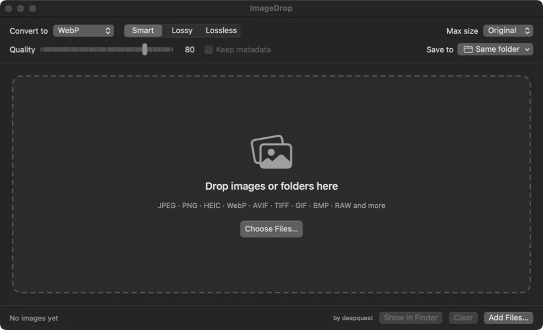

# ImageDrop

[](https://github.com/deepquest-io/ImageDrop/actions/workflows/build.yml)
[](https://github.com/deepquest-io/ImageDrop/releases/latest)

 

**A fast, native macOS drag-and-drop image converter, with WebP output tuned for small files at high quality.**

Created by **[deepquest](https://deepquest.code511.com/blog)** · Version 1.2.4 (build 8) · [Changelog](CHANGELOG.md)

<p align="center">
  
</p>

Drop one image, many images or whole folders on the window or the Dock icon, and they're converted right away. Several files convert at the same time.

**Output formats:** WebP · JPEG · PNG · HEIC · AVIF* · TIFF · GIF · BMP · JPEG 2000
**Input formats:** anything macOS can read: JPEG, PNG, HEIC/HEIF, WebP, AVIF, TIFF, GIF, BMP, PSD, camera RAW, ICO, JPEG 2000…

\* AVIF only shows up if your macOS version can write it. The format menu only lists what your Mac supports.

## Download

Get the latest `ImageDrop-vX.Y.Z-macOS.zip` from **[Releases](https://github.com/deepquest-io/ImageDrop/releases/latest)**, unzip it and move `ImageDrop.app` to Applications. It runs natively on both Apple Silicon and Intel Macs.

The app isn't notarized by Apple, so the first time you open it macOS will block it. To allow it, do one of these:
- **System Settings → Privacy & Security**, scroll down, and click **Open Anyway** next to ImageDrop.
- Or run this in Terminal: `xattr -dr com.apple.quarantine /Applications/ImageDrop.app`

## Build from source

Requirements: macOS 13 or later, plus Xcode or the Command Line Tools (`xcode-select --install`).

```bash
git clone https://github.com/deepquest-io/ImageDrop.git
cd ImageDrop
bash build.sh              # builds dist/ImageDrop.app
bash build.sh --install    # same, and copies it into /Applications
bash build.sh --universal  # Apple Silicon + Intel binary (needs full Xcode)
```

The first build downloads and compiles Google's **libwebp** through Swift Package Manager, so it takes about a minute. The app is self-contained: no Homebrew and no `cwebp` needed.

## Using it

1. Pick **Convert to**, then set Quality, Max size and Save to (your settings are remembered).
2. Drag images or folders onto the window (or the Dock icon), or use **⌘O**.
3. Each row shows the old size → new size, the % change and the dimensions. Click 🔍 to reveal a file in Finder.

The app never overwrites anything. `photo.png` becomes `photo.webp`, or `photo-1.webp` if that name is already taken. Folders are scanned recursively.

## WebP: small files, high quality

WebP is encoded with libwebp directly, using the settings that give the best size/quality balance:

| Setting | Value | Why |
|---|---|---|
| Quality | 80 (default) | Looks almost identical to the original and is usually 25–35% smaller than a JPEG of similar quality |
| `method` | 6 | Slowest and most thorough compression search, so you get the smallest file at that quality |
| `use_sharp_yuv` | on | Sharper colour edges with no colour bleeding on text, lines or saturated areas |
| Preset | `photo` for JPEG/HEIC/RAW sources | Better handling of noise and texture in camera images |
| Alpha | quality 90, best filter | Transparency stays clean but still compresses |
| Metadata | stripped | Smaller files; the image is rotated upright first, so orientation is kept |

**Modes**
- **Smart** (default): uses lossy for photos. For PNG/GIF/BMP/TIFF sources (screenshots, UI, logos) it also tries lossless and keeps that version if it is within 15% of the lossy size, so text and edges stay pixel-perfect.
- **Lossy**: always picks the smallest file.
- **Lossless**: exact pixels.

Tip: use quality 75–82 for web photos and 85–90 for hero images or photography portfolios. Setting **Max size** to 1920 or 2560 px often saves more than lowering the quality.

## Notes
- Animated GIF/WebP input: only the first frame is converted.
- JPEG/BMP output has no transparency, so transparent areas are filled with white.
- WebP's limit is 16383 px per side. For bigger images, set a Max size.
- Colours are converted to sRGB for WebP, which is what browsers expect.

## Releasing a new version
1. Update `VERSION`, increase `BUILD` by one, and add an entry at the top of `CHANGELOG.md`.
2. Commit and push to `main`.
3. GitHub Actions sees that this version hasn't been released yet. It builds a universal app, creates the `vX.Y.Z` tag and publishes a Release, using that version's changelog section as the release notes. Pushing a `vX.Y.Z` tag yourself works too.

## Project layout
```
.github/workflows/build.yml     CI: builds every push; publishes a Release for each new VERSION
VERSION / BUILD / CHANGELOG.md  version tracking
Package.swift                   SwiftPM manifest (depends on libwebp)
build.sh                        builds and bundles ImageDrop.app
Resources/AppIcon.icns          app icon (generated by tools/make-icon.swift if missing)
tools/make-icon.swift           draws the app icon with CoreGraphics
docs/screenshot.webp            README screenshot (14.7 KB, converted with WebP itself)
Sources/ImageDrop/
  App.swift                     app entry point, Dock-icon drops, menu commands
  ContentView.swift             UI: settings bar, drop zone, file list
  ConversionStore.swift         queue, parallel conversion, file naming, saved settings
  Converter.swift               decoding (ImageIO) and non-WebP encoding
  WebPEncoder.swift             libwebp encoder with tuned settings
  Formats.swift                 output formats and WebP modes
```

## Credits
ImageDrop was created by **deepquest**: <https://deepquest.code511.com/blog>

## License: free and open source
ImageDrop is free and open source under the [MIT License](LICENSE) © 2026 deepquest.

You can use, copy, modify, fork and redistribute it, including in commercial projects. The only condition is **credit**: keep the copyright notice and credit **deepquest | https://deepquest.code511.com/blog** in your copy or fork, including in the app's About window.

WebP encoding uses Google's [libwebp](https://chromium.googlesource.com/webm/libwebp) (BSD licence).
